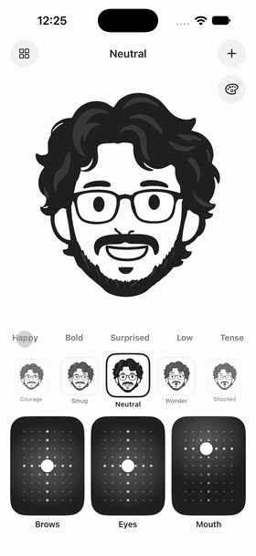
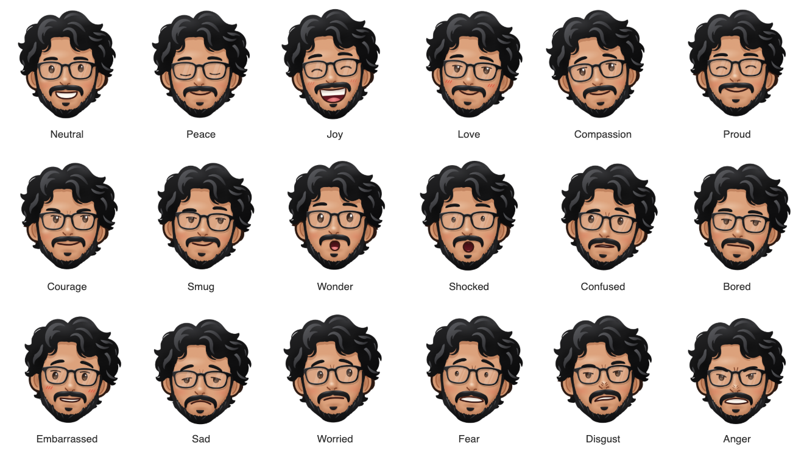
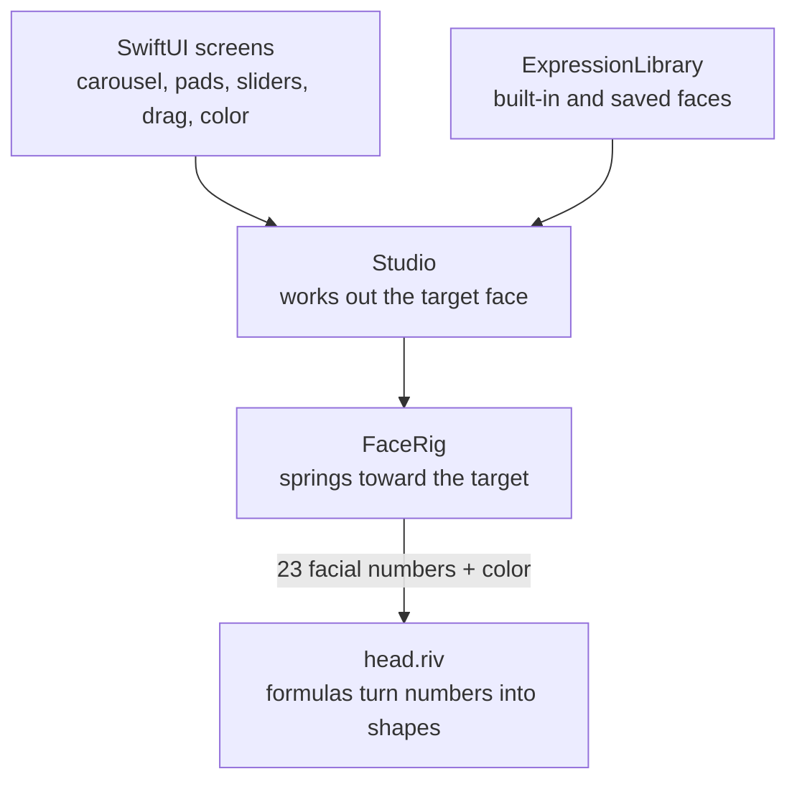

# Character Rigging

An iOS demo of a cartoon head you can puppeteer. Pick an expression, reshape the brows, eyes and mouth with camera-style pads, and save faces of your own. The character is rigged in [Rive](https://rive.app) and driven live from SwiftUI.

<p align="center">
  
</p>

## Features

- **17 built-in expressions** in five groups: Happy, Bold, Surprised, Low and Tense. Swipe the carousel and the face changes as you scroll.
- **Three pads** that each control one part of the face. The knob stays where you leave it, and a small dot marks the expression's own setting. Double-tap to go back to it.

  | Pad | Left to right | Bottom to top |
  |---|---|---|
  | Brows | Angry to sad | Lowered to raised |
  | Eyes | Stern to happy | Closed to wide |
  | Mouth | Closed to open | Frown to smile |

- **Drag the face** and the eyes lead, then the head follows.
- **Color or black and white**, with a smooth fade between the two.
- **Make your own.** Tap **+** for sliders over all 23 facial controls, then save, rename or delete faces in your library.
- **Always alive.** The character blinks and breathes on its own.



## Getting started

Built and tested with Xcode 27.2. The app targets iOS 18 and up.

1. Open `CharacterRigging.xcodeproj`. Xcode fetches the Rive runtime the first time.
2. Choose an iPhone simulator and run.

To run on a real iPhone, pick your team under **Signing & Capabilities** and set a bundle identifier of your own.

Run the tests with **Cmd-U**, or from a terminal with any simulator you have installed:

```sh
xcodebuild test -project CharacterRigging.xcodeproj -scheme CharacterRigging \
  -destination 'platform=iOS Simulator,name=iPhone 17'
```

## How it works

Everything flows one way. Swift decides what the face should be, and Rive decides how that looks.



- **Numbers are the only link** between Swift and Rive. They're matched by name, and a test checks that both sides agree.
- **Springs run in Swift.** Eyes are the quickest, then the face, then the head. The frame loop rests once everything has arrived.
- **An expression is just data:** 23 values in [`expressions.json`](App/Resources/expressions.json).
- **Saved pictures are drawn off screen** from a fresh character, so they never catch a blink.

## Project structure

```
App/
  Model/        Expressions, saving, facial controls, pad math, screen state
  Character/    Talking to Rive, motion and off-screen pictures
  Screens/      Main, Editor and Library
  Components/   Shared views and colors
  Resources/    head.riv, expressions.json and images
  Support/      Info.plist and the privacy manifest
Tests/          Mirrors App
rig/            The Rive source for the character
design/         Reference art and the vector head
docs/           Images for this README
project.yml     XcodeGen definition of the Xcode project
```

## Making changes

| To change | Edit |
|---|---|
| An expression | `App/Resources/expressions.json`, plus its `thumb_<id>` and `thumb_<id>_painted` images |
| What a pad does | `App/Model/FacePart.swift` |
| How the face moves | `App/Character/FaceMotion.swift` |
| How the character looks | `rig/scene.rml`, then publish it as below |
| A new facial control | `App/Model/FaceParameter.swift` and `rig/scene.rml`, using the same name in both |

**Adding, moving or removing files:** the Xcode project is generated with [XcodeGen](https://github.com/yonaskolb/XcodeGen). Run `xcodegen generate` afterward.

**Changing the character:** edit `rig/scene.rml`, then publish it with the [Rive CLI](https://rive.app/cli). Publishing needs a free Rive account (`rive login`).

```sh
cd rig
rive .                 # live preview while you edit
rive . --verify        # check for errors
rive . --publish       # build head.riv
cp build/head.riv ../App/Resources/head.riv
```

Files published on Rive's free plan are marked for its splash screen.

## License

[MIT](LICENSE)
